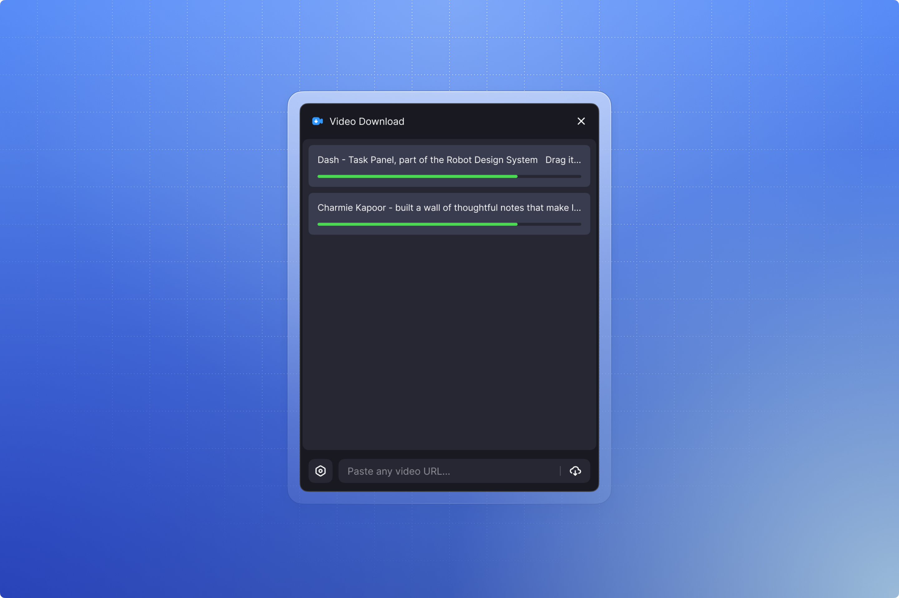

# Eagle Video Downloader

English | [中文](./README.md)

Download videos directly to Eagle from sites supported by yt-dlp. Built on [yt-dlp](https://github.com/yt-dlp/yt-dlp).

## Supported Platforms

YouTube, Twitter / X, TikTok, Bilibili, Instagram, Pinterest, Dribbble, Vimeo, and [many more](https://github.com/yt-dlp/yt-dlp/blob/master/supportedsites.md).

## Features

Supports sites backed by yt-dlp. Install yt-dlp via the dependency manager on first launch and use Eagle's official FFmpeg plugin for audio/video merging. Completed media is automatically imported into Eagle with titles, platform tags, and up to 500 characters of the description. Supports Chinese and English interfaces, real-time download progress, and video and image extraction for Pinterest Pins and Dribbble shots. Available downloads depend on the website and extraction results.

The original webpage URL is saved as the Eagle data source by default and can be turned off in Preferences. Resolution and frame rate settings guide format selection; fallback formats may have unrestricted quality, so downloads may exceed these settings.

## Network and External Services

Using the plugin and installing dependencies require an internet connection. When parsing a Dribbble shot page, the plugin sends the user-provided shot URL to the third-party [Jina Reader](https://r.jina.ai/) service and uses the returned page content to extract media links. Dribbble extraction depends on this service; its availability and response content affect Dribbble downloads.

Before a Dribbble download, the plugin shows the transmitted URL and purpose for confirmation; cancelling preserves the input. Media is downloaded to a system temporary directory and cleaned up after successful import. Imports create new Eagle items while existing items remain unchanged. Failed or interrupted download remnants can be removed from the eagle-video-downloader folder in the system temporary directory. Downloads support accessible content that can be retrieved without browser login.

## Installation

Install via [Eagle Community](https://community-cn.eagle.cool/plugins) or search for it in Eagle's plugin center.

Manual install: download the [latest release](https://github.com/fansanqiu/eagle-video-downloader/releases), then in Eagle go to Plugins → Developer Options → Import Local Project.

## First Run

On first launch, install yt-dlp (~30MB) from the dependency management page. ffmpeg uses Eagle's official FFmpeg plugin — if missing, a button in the dependency manager allows one-click navigation to download it from the Eagle Store.

## Usage

1. Copy a video link
2. Paste it into the plugin input box
3. Click the download button
4. The video is automatically imported to Eagle after download

## Development

```bash
npm install      # Install dependencies
npm run build    # Build plugin
npm run dev      # Development mode (watch for changes)
npm run package  # Packaging Plugin
```

The project uses esbuild for bundling, i18next for internationalization, yt-dlp for video extraction, and Eagle's official FFmpeg plugin.

## System Requirements

Eagle 4.0 or higher. Eagle's official FFmpeg plugin required. Internet connection required.

## License

MIT © [fansanqiu](https://github.com/fansanqiu)

For personal use only. Please comply with the terms of service of video platforms and applicable copyright laws.

## Acknowledgements

This project is based on [OlivierEstevez/eagle-twitter-video-downloader](https://github.com/OlivierEstevez/eagle-twitter-video-downloader). Thanks to the original author for the foundational work. Video extraction is powered by [yt-dlp](https://github.com/yt-dlp/yt-dlp), and audio/video merging and transcoding are powered by [FFmpeg](https://ffmpeg.org).
